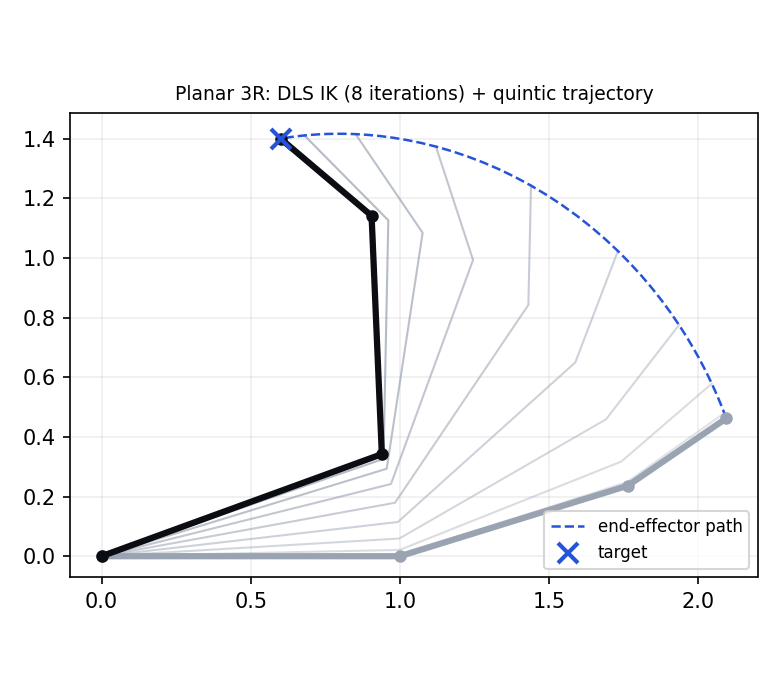
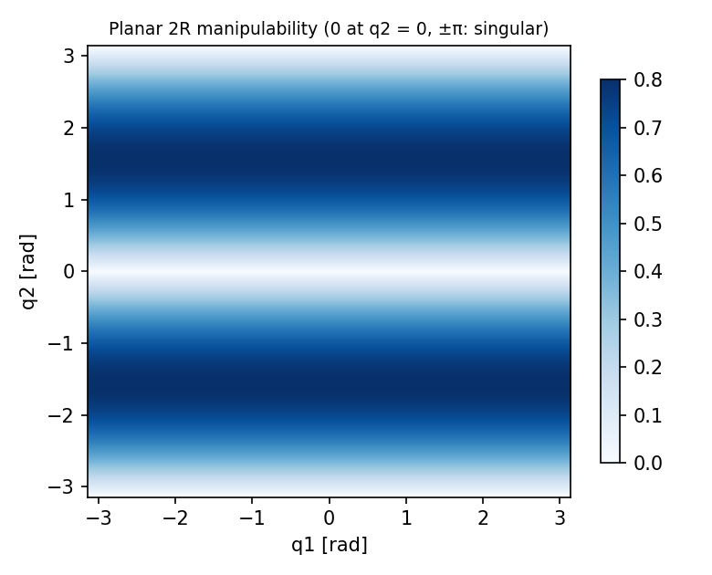

# robot-arm-kinematics

> A small, tested NumPy library for serial-manipulator kinematics: DH forward kinematics, geometric Jacobians,
> damped-least-squares inverse kinematics, manipulability and quintic joint trajectories.

 

<p align="center">
  
  
</p>

## Features

| Module | What it does |
| --- | --- |
| `transforms` | Standard DH transform, rotations, SO(3) log map (stable near 0 and π), 6-D pose error |
| `robot.SerialRobot` | FK for every frame, geometric Jacobian (revolute + prismatic), Yoshikawa manipulability, joint limits |
| `robot.SerialRobot.ik` | Damped least-squares IK, position-only or full pose, step clamping, limit clipping, random restarts |
| `models` | Planar 2R / 3R arms, **UR5** (official DH parameters), closed-form 2R IK (elbow up / down) |
| `trajectory` | Quintic joint-space trajectories with zero boundary velocity and acceleration |

## Quick start

```bash
python3 -m venv .venv && source .venv/bin/activate
pip install -r requirements-dev.txt -e .
pytest -q
```

```python
import numpy as np
from armkin import ur5

arm = ur5()
target = arm.fk([0.3, -1.2, 1.0, -0.5, 1.4, 0.2])      # a reachable 4x4 pose
res = arm.ik(target, q0=np.zeros(6), restarts=5)
print(res.success, res.iterations, res.position_error)  # True 12 4.7e-05
```

## Measured IK performance

Output of `python examples/benchmark_ik.py --n 500` (UR5, full 6-D pose, 500 random reachable targets, seed 0,
Apple Silicon, Python 3.9, NumPy 2.0). Tolerances: 0.1 mm position, 1 mrad orientation.

| restarts | success | median iterations | max position error | time / solve |
| --- | --- | --- | --- | --- |
| 0 | 83.8% | 28 | 0.100 mm | 6.1 ms |
| 5 | 97.0% | 27 | 0.100 mm | 13.1 ms |

From a single zero-configuration seed, DLS IK misses about 1 in 6 targets (local minima / joint-limit clipping);
five random restarts raise success to 97%. A closed-form UR5 solver would be the next step for guaranteed solutions.

## How the IK works

At each iteration the 6-D pose error `e = [Δp; log(R_target R^T)]` is mapped to a joint update with

```text
Δq = Jᵀ (J Jᵀ + λ² I)⁻¹ e
```

Damping `λ` keeps steps bounded near singularities; the step norm is clamped and joints are clipped to their limits.

## Tests

21 pytest cases, including: Jacobian vs finite differences (3R and UR5), UR5 home pose vs DH parameters,
numerical vs analytic 2R IK, unreachable targets reported as failures, joint limits respected, SO(3) log round-trips
near 0 and π, quintic boundary conditions and peak velocity.

## Regenerate figures

```bash
python examples/make_figures.py
```

## License

[MIT](LICENSE) © 2026 Weiqi Wang
